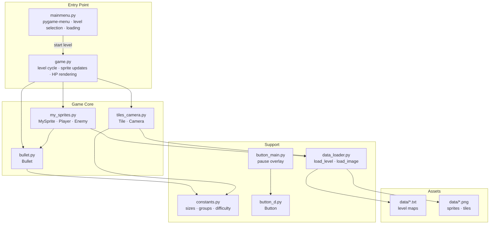
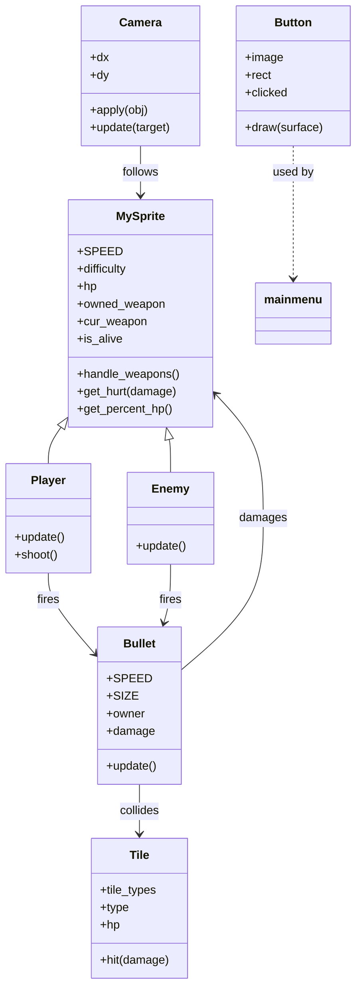
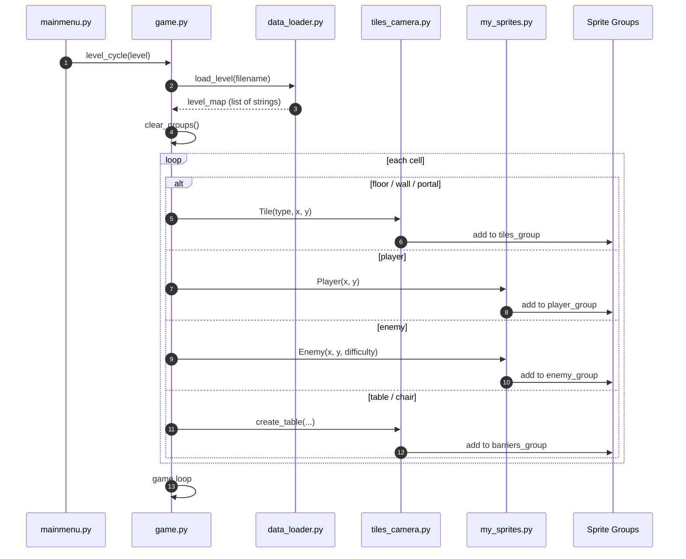
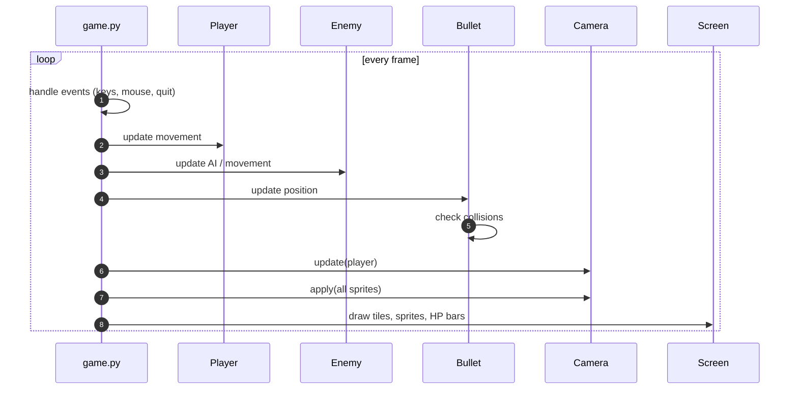

# Soul Knight — 2D Top-Down Action Game in Pygame

A playable 2D top‑down shooter built from scratch with **Python** and **Pygame**, featuring tile‑based levels, enemy AI, projectile combat, a follow camera, a main menu with difficulty selection, and an in‑game pause menu. Levels are defined as plain‑text maps, which makes the game easy to extend without touching the engine code.

The project was originally developed as an individual project for the 11th grade at Anichkov Lyceum and later refined into a complete playable build distributed as both a Python entry point and a Windows executable.

## Overview

The game is a compact top‑down action experience:

- The player moves with **WASD** or **arrow keys**.
- The weapon is aimed with the **mouse**, and **left click** fires.
- **E** interacts with objects, **Space** pauses the game.
- Levels are loaded from text files, where each character represents a tile, an enemy, the player, or a portal.
- The camera follows the player, and the world is rendered from sprite groups.
- Enemies have health, deal contact damage, and can be killed.
- Destructible props (tables, chairs) absorb bullets and can be destroyed.
- The game includes a main menu, a difficulty selector, a loading screen, and a pause overlay.

The codebase is intentionally modular: rendering, sprites, level loading, bullets, camera, constants, and UI are split into separate modules so the game can be extended or embedded into a larger project.

## Key Features

### Gameplay
- **Top‑down movement and aiming** — keyboard movement, mouse‑aimed weapon, and projectile combat.
- **Enemy AI** — enemies track the player, deal contact damage, and have difficulty‑scaled health pools.
- **Destructible environment** — tables, chairs, and walls interact with bullets; some props have finite HP.
- **Portal‑based level completion** — reaching the portal ends the level.
- **Health bars** — the player and enemies display health bars above their sprites.

### Level System
- **Text‑based level format** — each level is a `.txt` file where characters encode tiles, enemies, the player, the portal, and furniture.
- **Automatic padding** — rows are padded to the maximum width so maps can be authored without strict alignment.
- **Tile types** — floor, wall, portal, single table, horizontal table segments, vertical table segments, chairs.
- **Difficulty mapping** — levels 1–6 map to different enemy health profiles (`light`, `normal`, `hard`, `little boss`).

### UI and Menus
- **Main menu** built with `pygame-menu` — name input, level selection, play, and quit.
- **Difficulty selector** — six difficulty levels with a corresponding enemy health scale.
- **Loading screen** with a progress bar before each level.
- **Pause menu** — resume or quit from an in‑game overlay.
- **Camera** — follows the player and centers the view on the action.

### Engineering
- **Sprite groups** — `all_sprites`, `tiles_group`, `barriers_group`, `player_group`, `enemy_group`, `bullets_group`, `portal_group` keep the update and render loops clean.
- **Modular architecture** — engine, sprites, bullets, camera, level loader, constants, and UI are isolated in separate files.
- **Configuration via constants** — screen size, FPS, tile size, damage values, and difficulty mapping live in `constants.py`.
- **Packaging** — `game.spec` and `dist/` provide a PyInstaller build for Windows.

## Tech Stack

| Layer | Technologies |
|-------|--------------|
| **Language** | Python 3 |
| **Game engine** | Pygame 2.2 |
| **UI framework** | `pygame-menu` 4.3 |
| **Level format** | Plain‑text tile maps |
| **Packaging** | PyInstaller (`game.spec`) |
| **Testing / tooling** | Manual playtesting; CMake not used |

## Architecture



The entry point (`game.py`) owns the level cycle: it loads the map, generates tiles and sprites, updates the camera and groups, draws health bars, and handles the pause overlay. `mainmenu.py` provides the outer menu loop and delegates to `level_cycle`. Sprites, bullets, tiles, and the camera are independent classes that communicate through shared sprite groups and constants.

## Data Model and Game Entities



`MySprite` is the shared base for `Player` and `Enemy`, providing health, weapon state, and damage handling. `Bullet` carries its owner and damage, and resolves collisions against barriers and the opposite faction. `Tile` encapsulates destructible props and walls. `Camera` is a simple offset tracker applied to every sprite during rendering.

## How It Works

### Level loading



### Game loop



The loop keeps the camera centered on the player, updates all sprite groups, resolves bullet collisions, and redraws the health bars every frame. The pause overlay temporarily replaces the game loop with a button‑driven menu.

## Usage

### Prerequisites

- Python 3.8+
- Dependencies from `requirements.txt`:

```bash
pip install -r requirements.txt
```

### Run from source

```bash
python mainmenu.py
```

The entry point imports `game.py` and starts the main menu.

### Run the Windows build

The repository includes a PyInstaller build. Because of the way the executable resolves assets, it must be launched from a terminal:

```bash
dist/game.exe
```

### Controls

| Action | Input |
|--------|-------|
| Move | `WASD` or arrow keys |
| Aim | Mouse |
| Shoot | Left mouse button |
| Interact | `E` |
| Pause | `Space` |

### Level format

Levels live in `data/` as plain‑text files. The full legend is documented in `level_rules.md`. Key symbols:

- `n` — empty space without a tile
- `.` — floor
- `w` — wall
- `e` — enemy
- `@` — player spawn
- `p` — portal (level exit)
- `c` — chair
- `t`, `⌈-⌉`, `⊓`, `∃`, `⊔`, `∩`, `E`, `∪` — table variants

## What This Project Demonstrates

- **Game loop and real‑time rendering** — a complete frame loop with event handling, sprite updates, collision resolution, and camera movement.
- **Tile‑based level design** — a data‑driven level format that separates content from engine code.
- **Object‑oriented game entities** — inheritance (`MySprite` → `Player` / `Enemy`), composition (`Bullet`, `Tile`, `Camera`), and shared sprite groups.
- **Projectile combat and collision systems** — bullet ownership, faction‑aware damage, and destructible props.
- **UI integration** — main menu, difficulty selector, loading screen, and pause overlay built with `pygame-menu` and custom button drawing.
- **Modular Python architecture** — clear separation between entry points, sprites, bullets, camera, loaders, constants, and UI.
- **Packaging and distribution** — a working PyInstaller build for Windows.

## Possible Improvements

- Add sprite animation frames and walk/idle cycles instead of static images.
- Introduce a proper state machine for menus, gameplay, and pause instead of nested loops.
- Add sound effects and background music.
- Persist player progress and unlocked levels between sessions.
- Refactor level loading to validate maps and report malformed rows gracefully.
- Add unit tests for level parsing and tile type resolution.
- Replace manual coordinate math in `Camera` with a dead‑zone or smoothing follow.
- Add a level editor or a small scripting layer for enemy waves.
